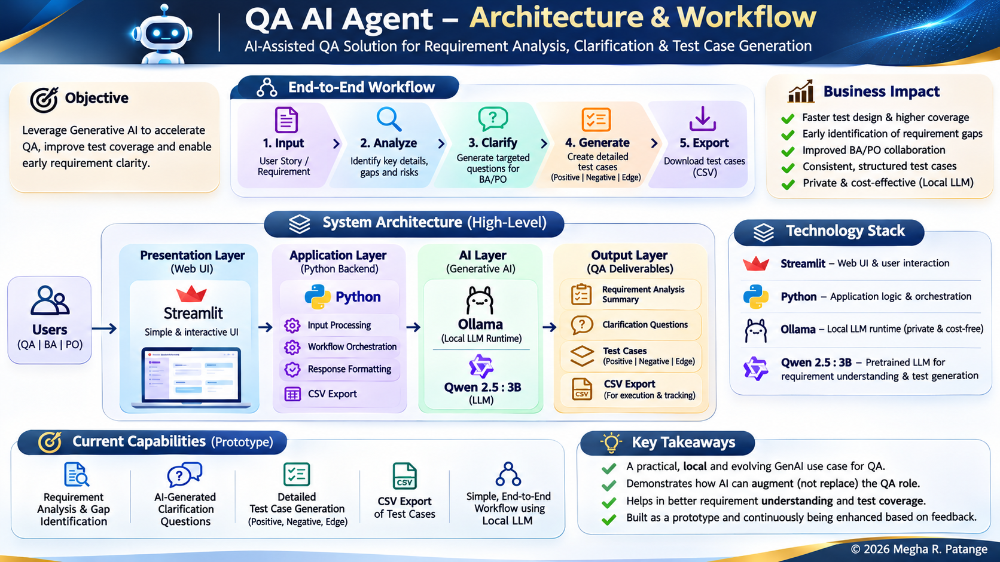

# 🚀 QA AI Agent – Intelligent Test Assistant

An AI-powered QA prototype designed to support early requirement analysis, intelligent test design and structured test case generation.

## 🎯 Objective

Leverage Generative AI to identify requirement gaps earlier, support QA decision-making and reduce repetitive test design activities.

## ✨ Key Capabilities

- Requirement analysis and gap identification
- Identification of ambiguities, risks and dependencies
- AI-generated BA/PO clarification questions
- Positive, negative, boundary and edge-case test generation
- Structured test case review
- CSV export

## 🔄 End-to-End Workflow

User Story → Requirement Analysis → Clarifications → Test Case Generation → CSV Export

## 🏗️ System Architecture

The application uses a locally hosted LLM for AI-assisted requirement analysis and test case generation.

## ⚙️ Technology Stack

| Technology | Purpose |
|---|---|
| Python | Application logic |
| Streamlit | Interactive user interface |
| Ollama | Local LLM runtime |
| Qwen 2.5:3B | Generative AI model |
| Pandas | Data processing and CSV export |

## 📈 Intended Business Value

- Early identification of requirement gaps
- Improved requirement clarity
- Reduced repetitive QA activities
- Consistent test case documentation
- Support for shift-left testing
- AI-assisted quality engineering with human oversight

## 🎬 Product Demonstration

Working application demo coming soon.

## 📌 Project Status

Functional prototype under continuous refinement.

## 🔒 Source Code

This repository serves as a public project showcase. 
The application source code and implementation logic are maintained privately.

## 👩‍💻 Designed and Developed By

**Megha R. Patange**

Senior QA Lead | Quality Engineering | Generative AI

© 2026 Megha R. Patange. All rights reserved.
